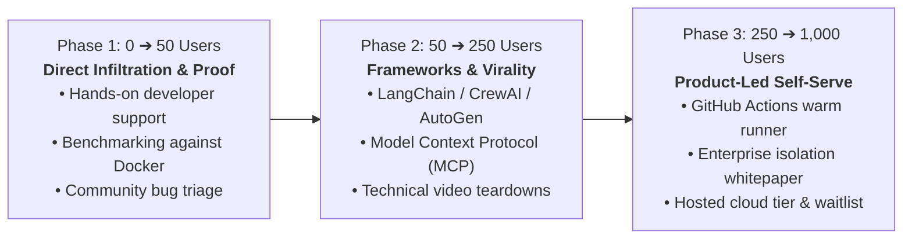

# 🚀 The AI Agent Sandbox 0 to 1,000 Developer Users GTM Strategy

> **A Phased, Product-Led Growth (PLG) Blueprint for Scaling MicroVM Sandboxes in the AI Agent Economy.**

---

## 🏛️ Executive Framework: The 3 Growth Phases



---

## 📍 Phase 1: 0 to 50 Users — "Founder-Led Infiltration & Hard Problem Solving"

### Objective
Acquire the first 50 daily active developers by personally solving their painful infrastructure bugs in public.

### Target Developer Personas
1. **AI Agent Framework Builders:** Developers building autonomous code execution loops (e.g. OpenHands, SWE-agent, Cline, Claude Code clones).
2. **Coding Agent Evaluation & RL Researchers:** Researchers training LLMs on programming benchmarks (SWE-bench, Repo2RLEnv) who need safe, reproducible execution environments.
3. **Browser & Computer-Use Engineers:** Teams running headless Chromium instances (Stagehand, Browser Use) that need hardware isolation without 30-second Docker spin-ups.

### Tactics & Execution
1. **The Community "Troubleshooter" Strategy:**
   - Join the top 20 AI developer Discords (LiteLLM, E2B, Composio, Bolna, LangChain, Rivet).
   - Search for keywords: `timeout`, `docker escape`, `slow startup`, `permission denied`, `sandbox crash`.
   - Instead of pitching a link, provide the direct technical diagnosis:
     > *"That error happens because Docker shared memory overflows during multi-turn LLM agent execution. Here is a 3-line fix, or you can run this in an isolated microVM with <50ms startup using BoxLite."*
2. **The "10x Faster Benchmark" Release:**
   - Publish a transparent, reproducible benchmark comparing:
     * Docker container startup vs. Firecracker / libkrun microVM startup.
     * Memory overhead per idle agent (Docker: ~250MB vs. MicroVM: ~35MB).
   - Post to Hacker News (`Show HN: A 30ms MicroVM Sandbox for AI Coding Agents`) and Reddit (`r/MachineLearning`, `r/LocalLLaMA`).
3. **White-Glove Integration for 10 Open-Source Projects:**
   - Open pull requests adding the sandbox as an official execution backend in high-visibility agent repositories.
   - Example: PR to `SWE-agent/SWE-ReX` or `huggingface/Repo2RLEnv` replacing heavy Docker daemon requirements with lightweight embeddable sandboxes.

---

## 📍 Phase 2: 50 to 250 Users — "Ecosystem Integration & Technical Content Engine"

### Objective
Transition from manual outreach to inbound developer acquisition by embedding directly into where AI agent developers build.

### 1. The Model Context Protocol (MCP) Trojan Horse
- Build and open-source a turnkey **Sandbox MCP Server** (`mcp-server-sandbox`).
- When developers use Claude Desktop, Cursor, or Windsurf, your sandbox is one click away in their config:
  ```json
  {
    "mcpServers": {
      "secure-sandbox": {
        "command": "sandbox-mcp",
        "args": ["--isolated", "--timeout", "30s"]
      }
    }
  }
  ```
- This immediately exposes your runtime to tens of thousands of power developers without them changing their application code.

### 2. High-Impact Technical Video Demonstrations
Developers do not read marketing fluff; they watch short, high-density terminal videos:
- **Video 1: "Testing Malicious Agent Code in a Sandbox (Fork Bomb & `rm -rf /`):"**  
  Show an AI agent tricked into executing system destruction, showing how the microVM absorbs the crash and restores in 20 milliseconds without touching host memory.
- **Video 2: "Docker vs. MicroVM Cold-Start Shootout:"**  
  Side-by-side terminal split showing 100 agent sandboxes spinning up in parallel.

### 3. Native SDK Integrations
Publish zero-dependency, idiomatic client libraries:
- `pip install agent-sandbox`
- `npm install @agent/sandbox`
- `cargo add agent-sandbox`

Target 1-line developer ergonomics:
```python
from sandbox import MicroVM

with MicroVM(image="python:3.11-slim") as vm:
    result = vm.exec("python -c 'print(2+2)'")
    print(result.stdout) # 4 (executed in 28ms)
```

---

## 📍 Phase 3: 250 to 1,000 Users — "Product-Led Growth (PLG) & Enterprise Funnels"

### Objective
Create scalable distribution flywheels that turn free open-source users into paying enterprise and hosted cloud customers.

### 1. The GitHub Actions CI/CD Warm Runner Playbook
- Package the sandbox runtime as a **self-hosted GitHub Actions runner with warm VM snapshot reuse**.
- **The Value Proposition:** Drop CI test times from 4 minutes to 15 seconds by reusing booted microVM memory snapshots.
- Developers install it to speed up their own PR checks, inadvertently adopting your sandbox infrastructure across their entire company.

### 2. The Cloud Hosted Tier (`api.sandbox.ai`)
- Provide a managed hosted API for teams who do not want to manage local KVM/hypervisors on their own servers:
  * **Free Tier:** 100 hours of microVM execution per month (powers indie hackers, students, and hackathon projects).
  * **Pro Tier ($20–$50/mo):** Persistent disk volumes, dedicated IP addresses, GPU passthrough.
  * **Enterprise:** SOC2 Type II compliance, VPC peering, dedicated tenant clusters.

### 3. Developer Documentation & "Cookbook" Culture
- Build an interactive recipe hub:
  * *Cookbook 1:* "Building a Secure SWE-bench Agent Harness"
  * *Cookbook 2:* "Running Web Scraping without IP Leakage via Isolated Sandboxes"
  * *Cookbook 3:* "Executing Untrusted Python Code in Multi-Tenant LLM Chatbots"

---

## 📊 Key Performance Indicators (KPIs) to Track

| Metric | Phase 1 (0–50) | Phase 2 (50–250) | Phase 3 (250–1,000) |
| :--- | :---: | :---: | :---: |
| **GitHub Stars** | 100 – 500 | 500 – 2,500 | 2,500 – 7,500+ |
| **Weekly Active Sandboxes** | 50 | 500 | 5,000+ |
| **Community Discord Members** | 50 – 150 | 150 – 800 | 800 – 3,000+ |
| **Average Sandbox Boot Time** | <50ms | <30ms | <15ms (warm fork) |
| **External Contributors** | 2 – 5 | 10 – 25 | 50+ |
| **Waitlist / Enterprise Leads** | 10 | 50 | 250+ |
