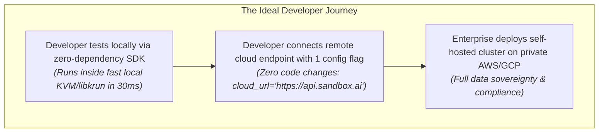

# ⚔️ AI Sandbox Architecture Teardown & Competitor Benchmarks

> **A Deep Technical Comparison of Next-Gen AI Code Execution Sandboxes.**

---

## 🏛️ Architectural Landscape Overview

| Platform | Core Isolation Technology | Typical Cold Start | Memory Overhead | Target Audience | Source Model |
| :--- | :--- | :---: | :---: | :--- | :--- |
| **BoxLite** | Embedded MicroVM (`libkrun` / KVM / Rust) | **~25–45 ms** | **~35 MB** | Edge & Embedded Agent Runtimes | Open Source (Rust core) |
| **E2B** | Cloud Firecracker MicroVMs + Go Controller | **~150–300 ms** | **~64 MB** | Cloud Code Interpreters / LLM Agents | Open Source + Hosted Cloud |
| **Modal** | Custom Container Engine (gVisor / runc hybrid) | **~500–900 ms** | **~128 MB** | Serverless Python & Batch ML | Proprietary Hosted Cloud |
| **Daytona** | Dev Containers + Docker / MicroVM hybrid | **~2–5 sec** | **~250 MB** | Standardized Developer Workspaces | Open Source + Enterprise |
| **Rivet (agentOS)**| V8 Isolate / WASM + Container fallbacks | **~5–15 ms** | **~20 MB** | Game Servers & Lightweight Agents | Open Source |
| **Docker (Standard)**| Linux Namespaces & cgroups | **~800–1,500 ms** | **~150 MB** | General Backend Containers | Open Source |

---

## 🔬 Detailed Competitor Teardowns

### 1. E2B ($37M+, Series A)
- **Strengths:** Market leader in mindshare. Strong Python and TypeScript SDKs. Direct partnerships with major LLM labs.
- **Weaknesses:** Requires cloud roundtrip for every execution (no lightweight local embeddable mode). Developers running on local laptops or edge devices cannot use it offline. High cloud pricing for long-running stateful sessions.
- **The Wedge against E2B:** **Local-first embeddability**. Developers want to run tests locally on Mac/Linux during development without paying cloud API bills or sending sensitive code over the network.

### 2. Modal Labs ($40M+)
- **Strengths:** World-class developer experience for Python serverless computing. GPU leasing and scheduling is seamless.
- **Weaknesses:** Completely closed-source backend. Expensive for fine-grained, high-frequency agent tool calls (e.g. running 1,000 1-second bash commands).
- **The Wedge against Modal:** Open-source transparency, self-hostability on private Kubernetes/bare-metal, and zero vendor lock-in.

### 3. Daytona ($24M, Series A)
- **Strengths:** Strong focus on developer environment management (Dev Containers, full IDE injection).
- **Weaknesses:** Geared towards human developer workspaces (spinning up VS Code instances), rather than sub-second transient execution for autonomous LLM agent loops.
- **The Wedge against Daytona:** Extreme lightness (<50ms startup vs Daytona's multi-second container boot) designed specifically for programmatic agent tool calling.

---

## ⚡ The Winning Formula for Next-Gen Sandboxes

1. **Dual Execution Engine:**  
   Allow running locally on Mac/Linux (via KVM/Virtualization.framework) for free, and switching to remote cloud execution by changing a single parameter.
2. **Warm Memory Snapshotting:**  
   Pre-boot common environments (Python with PyTorch/vLLM/Pandas preloaded) and fork from frozen memory states in under 10 milliseconds.
3. **Hardware-Enforced Security:**  
   Never rely solely on software-level Linux namespaces (Docker). True hardware-isolated microVMs prevent kernel exploits and multi-tenant memory snooping.
